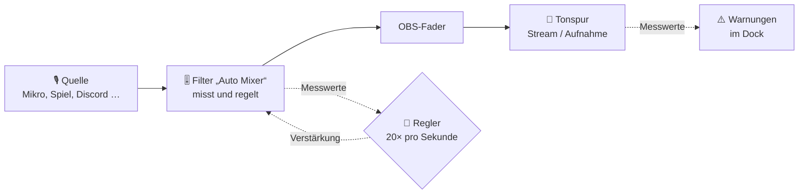

<div align="center">

# 🎚️ Auto Mixer für OBS

**Nie wieder „Dein Spiel ist zu laut, man versteht dich nicht“ im Chat.**

Das OBS-Plugin misst laufend die Lautheit jeder Audioquelle und jeder Tonspur, erkennt zu laute oder zu leise Spuren und gleicht sie **automatisch und unauffällig** aus. Alles läuft lokal auf deinem PC: keine Cloud, keine KI, keine Telemetrie.

[](https://github.com/BellocccYT/obs-audio-mixer/releases/latest)
[](https://github.com/BellocccYT/obs-audio-mixer/releases)
[](https://obsproject.com)
[](LICENSE)

### [⬇️ Setup für Windows herunterladen](https://github.com/BellocccYT/obs-audio-mixer/releases/latest)

</div>

---

## ✨ Was es kann

| | |
|---|---|
| 📏 **Misst wie ein Profi-Lautheitsmesser** | Lautheit nach EBU R128 / ITU-R BS.1770 (Momentary 400 ms, Short-term 3 s), True Peak mit 4-facher Überabtastung und Übersteuerung. Pro Quelle **und** pro OBS-Tonspur, also genau das, was im Stream und in der Aufnahme landet. |
| 🎭 **Versteht, was wo läuft** | Jede Quelle bekommt eine Rolle: Stimme, Spiel, Chat (Discord/Mitspieler), Musik, Alerts, Desktop. Die Rolle wird automatisch vorgeschlagen, z. B. Mikrofon → Stimme, `discord.exe` → Chat, Spotify → Musik. |
| 🎛️ **Presets für jede Situation** | Stimme vor Spiel, Spiel vor Stimme, Ausgeglichen, Competitive, Just Chatting, Musik, Gäste/Podcast, eigene Presets und **Automatisch**: Das Plugin wählt selbst, nach Szene oder danach, was gerade passiert. |
| 🦆 **Ducking** | Sprichst du, wird das Spiel ein paar dB leiser. Nach dem letzten Wort wartet es kurz und kommt dann sanft zurück. |
| 🛡️ **Schreischutz und Limiter** | Ein Schrei oder eine Explosion wird in etwa 50 ms abgefangen. Ein True-Peak-Limiter sorgt dafür, dass auch beim Hochregeln nie etwas übersteuert. |
| 🧠 **Lernt die Grundlautheit** | Die Lautheit eines Spiels wird über Minuten gemittelt. Eine einzelne Explosion verschiebt die Balance nicht, ein dauerhaft lauteres Spiel schon. |
| 😌 **Kein Pumpen** | Totzone von ±1 LU, leiser geht es schnell, lauter langsam. In Stille wird nie hochgeregelt, sonst würde das Rauschen laut. |
| ⚠️ **Warnt, bevor der Chat es tut** | Zu laut, zu leise, übersteuert, Gesamtmix zu laut. Gewarnt wird erst nach ein paar Sekunden, nicht bei jeder Spitze. Bonus: **„Du sprichst, aber dein Mikro ist stumm!“** |
| 👀 **Erst mal nur beobachten** | Im Modus „Nur beobachten“ misst und warnt der Auto Mixer, ändert aber nichts, und zeigt, was er tun würde. |
| 🎯 **Einmessen in 30 Sekunden** | Normal sprechen und spielen, danach schlägt das Plugin Startwerte vor und sagt dir, ob dein Mikro zu leise ist, rauscht oder schon vor OBS übersteuert. |
| 🔒 **Dein Fader bleibt deiner** | Geregelt wird über einen eigenen Filter am Ende der Filterkette, der OBS-Fader bleibt bei dir. Bewegst du ihn, lässt der Auto Mixer die Quelle in Ruhe. |

## ⚙️ So funktioniert's



Der Filter misst die Quelle **vor** seiner eigenen Verstärkung. Der Regler rechnet den Fader dazu und vergleicht mit dem Ziel des Presets. Danach gibt er die neue Verstärkung an den Filter weiter, der sie sample-genau und geglättet anwendet. So gibt es kein Gerangel mit dem Fader und keine Knackser.

## 🚀 Installation (Windows)

1. **[Setup herunterladen](https://github.com/BellocccYT/obs-audio-mixer/releases/latest)** (`obs-audio-mixer-…-windows-x64-setup.exe`) und starten.
2. OBS starten. Das Dock **Auto Mixer** erscheint automatisch rechts.
3. **Ausprobieren:** Der Auto Mixer startet im Modus **„Nur beobachten“**. Er misst, warnt und zeigt in Klammern, was er anpassen würde, z. B. `(−6 dB)`.
4. **Regeln:** Im Dock oben auf **Regeln** stellen. Der Auto Mixer fragt einmal, ob er seinen Filter an deine Quellen hängen darf. Fertig! 🎉

> [!NOTE]
> **Windows meldet „Der Computer wurde durch Windows geschützt“?** Das Setup ist noch nicht digital signiert. Klick auf **Weitere Informationen → Trotzdem ausführen**.

> [!WARNING]
> **„Fehler beim Laden von Plugins“?** Unter Windows 11 blockiert die *Intelligente App-Steuerung* (Smart App Control) unsignierte Plugins. Im OBS-Log steht dann `LoadLibrary failed … (4551)`. Bis es eine signierte Version gibt, hilft nur, die Intelligente App-Steuerung abzuschalten (Windows-Sicherheit → App- & Browsersteuerung).

Voraussetzung ist **OBS Studio 31 oder neuer**. Deinstallieren kannst du über **Windows-Einstellungen → Apps**. Klick vorher in OBS unter **Auto Mixer → Einstellungen → Allgemein** auf **„Filter von allen Quellen entfernen“**, sonst bleiben unbekannte Filter in deinen Quellen stehen.

<details>
<summary>Manuell mit der ZIP-Datei installieren</summary>

1. Unter [Releases](https://github.com/BellocccYT/obs-audio-mixer/releases/latest) die Datei `obs-audio-mixer-…-windows-x64.zip` herunterladen
2. OBS schließen
3. Den Inhalt der ZIP nach `C:\ProgramData\obs-studio\plugins\` entpacken. Danach existiert `C:\ProgramData\obs-studio\plugins\obs-audio-mixer\bin\64bit\obs-audio-mixer.dll`.
4. OBS starten → **Docks → Auto Mixer**

</details>

<details>
<summary>macOS und Linux (experimentell)</summary>

Die Releases enthalten auch Pakete für macOS und Ubuntu. Sie werden automatisch gebaut, wurden aber noch nicht auf echten Geräten getestet. Rückmeldungen sind sehr willkommen!

</details>

## 🎭 Rollen

| Rolle | Typisch | Automatischer Vorschlag |
|---|---|---|
| **Stimme** | dein Mikrofon | Audio-Eingang (`wasapi_input_capture` …), außer Capture-Cards |
| **Spiel** | Spielaufnahme, Anwendungsaudio des Spiels, Capture-Card | Spielaufnahme, Anwendungsaudio eines unbekannten Programms, Videogerät mit Ton |
| **Chat** | Discord, TeamSpeak, Mitspieler | Anwendungsaudio von `discord.exe`, `ts3client` …, oder „Discord“ im Namen |
| **Musik** | Spotify, Musikplayer | Anwendungsaudio von `spotify.exe`, `vlc.exe` …, oder „Musik“ im Namen |
| **Alerts/Sounds** | Browserquellen für Alerts, Soundeffekte | Browserquelle, Medienquelle |
| **Desktop** | Desktop-Audio (alles gemischt) | Desktop-Audio, Browser |
| **Ignorieren** | Webcam-Mikro, alles, was in Ruhe bleiben soll | Webcam |

Du kannst jede Rolle im Dock oder unter **Einstellungen → Rollen** ändern. Gespeichert wird per Quellen-ID, Umbenennen ist also kein Problem.

> [!TIP]
> **Läuft alles über Desktop-Audio?** Dann sind Spiel, Musik und Discord ein einziger Brei, den niemand getrennt regeln kann. Füge für das Spiel und für Discord je eine **Anwendungsaudioaufnahme** hinzu (Quellen → **+** → *Anwendungsaudioaufnahme*), wähle das Programm aus und schalte Desktop-Audio stumm. Der Auto Mixer weist dich im Dock darauf hin.

## 🎛️ Presets

Ein Preset legt fest, wie laut die Hauptrolle sein soll, welchen Abstand die anderen Rollen dazu haben, wie stark der Rest beim Sprechen leiser wird (Ducking) und wie schnell angepasst wird.

| Preset | Idee | Startwerte |
|---|---|---|
| **Stimme vor Spiel** (Standard) | Du bist immer klar verständlich | Stimme −16 LUFS, Spiel −10 LU (beim Sprechen weitere −4 dB), Chat −1 LU, Musik −18 LU, Alerts −4 LU |
| **Spiel vor Stimme** | Story, Horror, Atmosphäre: das Spiel trägt den Stream | Spiel −16 LUFS, Stimme −2 LU, beim Sprechen Spiel nur −2 dB |
| **Ausgeglichen** | Beides gleich wichtig | Stimme −16 LUFS, Spiel −5 LU, Ducking −3 dB |
| **Competitive** | Schritte und Sounds hörbar lassen, Dynamik erhalten | Stimme −16 LUFS, Spiel −7 LU, kein Ducking, langsam, Spitzen nur per Limiter |
| **Just Chatting** | Nur reden, der Rest ist Hintergrund | Stimme −16 LUFS, Spiel/Musik −20 LU, Ducking −8 dB |
| **Musik** | Musik, DJ, Karaoke im Vordergrund | Musik −14 LUFS, Stimme −2 LU |
| **Gäste / Podcast** | Alle Stimmen gleich laut (Mikro + Discord) | Stimme und Chat angeglichen, Rest −18 LU |
| **Automatisch** | Wählt selbst | siehe unten |

Die Startwerte stehen als Daten in [`data/presets.json`](data/presets.json) und lassen sich dort feinjustieren. **Eigene Presets** legst du unter **Einstellungen → Presets** an („Neu“ übernimmt die gerade wirksamen Werte). Dort kannst du sie auch als JSON **importieren und exportieren**.

**Automatisch** wählt in dieser Reihenfolge:

1. **Szene → Preset:** Unter **Einstellungen → Szenen** ordnest du z. B. der Szene „Just Chatting“ das Preset *Just Chatting* zu.
2. **Aktivität:** Läuft lange kein Spielton, kommt *Just Chatting*. Bei viel Sprechen über lautem Spiel kommt *Stimme vor Spiel*. Läuft das Spiel und du sprichst kaum, kommt *Spiel vor Stimme*. Bei viel Musik oder vielen Gesprächen mit Gästen kommt *Musik* bzw. *Gäste / Podcast*.

Gewechselt wird nie im Sekundentakt: Ein anderes Preset muss eine halbe Minute am Stück besser passen, und nach einem Wechsel bleibt es mindestens zwei Minuten.

## 🔧 Wie geregelt wird

- **10–20× pro Sekunde** außerhalb des Audio-Threads. Verglichen wird die Short-term-Lautheit (bei Stimmen nur die Sprachabschnitte) mit dem Ziel des Presets. Der OBS-Fader wird dabei mitgerechnet.
- **Totzone ±1 LU:** Kleine Abweichungen bleiben unangetastet.
- **Tempo:** Leiser geht es mit bis zu 6 dB/s, lauter mit 1,5 dB/s (Preset-Tempo *normal*; *langsam* und *schnell* gibt es auch).
- **Nur bei Aktivität:** Stimmen werden nur geregelt, während gesprochen wird, alles andere nur, wenn es hörbar ist. In Stille wird nie hochgeregelt.
- **Grenzen** pro Quelle, Standard −30 dB bis +12 dB.
- **Ducking** mit 0,5–1 s Wartezeit nach dem Sprechen.
- **Schreischutz:** Liegt die Momentary-Lautheit plötzlich 8 LU über dem Ziel oder geht der True Peak über −1 dBTP, wird sofort abgesenkt (Attack ca. 50 ms) und danach sanft wieder freigegeben. Bei *Competitive* ist er aus, dort fängt nur der Limiter Spitzen ab.
- **True-Peak-Limiter** im Filter mit 1,5 ms Lookahead. Dadurch übersteuert auch ein Hochregeln nie.
- **Langzeit-Lernen:** Die Grundlautheit wird über Minuten gemittelt, Ausreißer werden ignoriert. Bleibt es länger deutlich lauter oder leiser, wird schnell nachgelernt.
- **Weicher Übergang:** Ein- und Ausschalten der Regelung blendet über 2 Sekunden über.
- **Schloss:** Bewegst du einen Fader oder klickst im Dock auf 🔒, bleibt die Quelle unangetastet, bis du sie wieder freigibst.

## 🖥️ Das Dock

- **Oben:** Ein/Aus, Preset (bei *Automatisch* mit dem gerade wirksamen Preset in Klammern), Modus *Regeln* / *Nur beobachten*, **Einmessen …** und **Einstellungen …**
- **Warnungen** in Rot: Gesamtmix zu laut, Streamspur übersteuert, Mikro stumm, obwohl du sprichst. In Gelb steht der Hinweis zu Desktop-Audio.
- **Tonspuren:** die Streamspur immer, die anderen, sobald dort Ton ankommt
- **Quellen:** Name, Rolle, Pegelbalken mit **Zielmarke**, aktuelle Anpassung in dB (im Beobachtungsmodus als Vorschlag in Klammern), Statuspunkt (🟢 passt, 🟠 zu laut, 🔵 zu leise, 🔴 übersteuert, ⚪ gerade still) und Schloss
- **Verlauf:** z. B. „Spiel 4 dB leiser, weil du sprichst“ oder „Automatisch: Just Chatting (lange kein Spielton)“

Der Pegelbalken zeigt die Short-term-Lautheit, der helle Strich die Momentary-Lautheit, die kleine Marke oben den True Peak und die senkrechte Linie das Ziel des Presets, jeweils so, wie es nach Filter und Fader im Mix ankommt.

## 🎯 Einmessen

**Einmessen …** im Dock: 30 Sekunden ganz normal sprechen und spielen. Danach zeigt der Assistent für jede Quelle die gemessene Lautheit, einen Startwert und Hinweise:

- *zu leise, auch mit voller Verstärkung:* Pegel am Gerät oder in der Quelle erhöhen
- *übersteuert schon vor OBS:* Gain am Mikrofon oder Interface etwas senken
- *rauscht deutlich:* der OBS-Filter „Rauschunterdrückung“ hilft

Außerdem schlägt er ein passendes Preset vor. Erst mit **Übernehmen** wird etwas geändert. Danach startet die Regelung gleich mit passenden Werten.

## ⌨️ Tastenkürzel

Unter **OBS-Einstellungen → Tastenkürzel**:

- **Auto Mixer: Preset 1–9** in der Reihenfolge der Preset-Liste, der Name steht dabei
- **Auto Mixer: Preset „Automatisch“**
- **Auto Mixer: Pausieren / Fortsetzen**
- **Auto Mixer: Neu einmessen**: Die gelernten Pegel werden verworfen und neu gelernt, z. B. nach einem Spielwechsel.

<details>
<summary>📋 Alle Einstellungen</summary>

| Reiter | Einstellung | Bedeutung |
|---|---|---|
| Allgemein | Ziel-Lautheit Stimme | Bezugswert für alle Presets (Standard −16 LUFS). Leiser oder lauter verschiebt alle Ziele gleichmäßig. |
| | Ziel Gesamtmix | Zielmarke der Tonspuren (Standard −14 LUFS) |
| | Gesamtmix zu laut ab | Warnung, wenn die Streamspur länger darüber liegt (Standard −10 LUFS) |
| | Streamspur | Automatisch (beim Streamen aus dem Stream-Output erkannt, sonst Spur 1) oder fest Spur 1–6 |
| | Obergrenze Limiter | True-Peak-Grenze des Filters (Standard −1 dBTP) |
| | Anpassung je Quelle | Standard-Grenzen für neue Quellen (−30 dB bis +12 dB) |
| | Fader sperrt Quelle | Bewegst du einen Fader, wird die Quelle gesperrt |
| | Filter | An alle Quellen mit Rolle hängen oder von allen Quellen entfernen |
| Rollen | | Rolle, Vorschlag, Grenzen und Sperre je Quelle; „Alle Vorschläge übernehmen“ |
| Presets | | Mitgelieferte Presets ansehen, eigene anlegen, kopieren, löschen, importieren, exportieren |
| Szenen | | Zuordnung Szene → Preset für „Automatisch“, und ob sonst nach Aktivität gewählt wird |
| Warnungen | | Ab wie viel LU zu laut oder zu leise, nach wie vielen Sekunden, ab welchem True Peak übersteuert, Warnung bei stummem Mikro |

</details>

## 🔒 Datenschutz

- **Der Auto Mixer verbindet sich mit nichts.** Keine Cloud, keine KI-Dienste, keine Telemetrie, keine Updates im Hintergrund. Es ist reine Signalverarbeitung auf deinem PC.
- Es wird nichts aufgezeichnet. Im Arbeitsspeicher liegen nur Messwerte der letzten Sekunden.
- Die Einstellungen liegen lokal in `%APPDATA%\obs-studio\plugin_config\obs-audio-mixer\`. Die Filter speichert OBS wie alle Filter mit deiner Szenensammlung.

## 🛠️ Fehlerbehebung

Details stehen im OBS-Log (**Hilfe → Protokolldateien**), alle Meldungen des Plugins beginnen mit `[auto-mixer]`.

| Problem | Lösung |
|---|---|
| Eine Quelle fehlt im Dock | Im Dock erscheinen nur Quellen, die in den letzten 30 s Ton geliefert haben. Alle stehen unter **Einstellungen → Rollen**. |
| Eine Quelle wird nicht geregelt | Rolle *Ignorieren*? Gesperrt (🔒)? Modus *Nur beobachten*? Hat sie den Filter „Auto Mixer“ und ist er eingeschaltet? |
| Das Spiel ist nicht vom Rest zu trennen | Alles läuft über Desktop-Audio, siehe [Rollen](#-rollen). |
| „Übersteuert“ bei einer Quelle | Der True Peak ist zu hoch, oft schon vor OBS. Gain am Gerät senken oder den Assistenten **Einmessen** fragen. |
| Gesamtmix zu laut | Eine Quelle ist *Ignorieren* oder gesperrt, oder es laufen zu viele Quellen gleichzeitig. Die Ziel-Lautheit unter **Allgemein** etwas senken. |
| Es regelt zu hektisch oder zu träge | Im Preset das Tempo ändern (Kopie anlegen), oder *Competitive* für mehr Dynamik |
| Plugin entfernen | Erst **Einstellungen → Allgemein → Filter von allen Quellen entfernen**, dann deinstallieren |

Ein Fehler oder eine Idee? Schreib ein [Issue](https://github.com/BellocccYT/obs-audio-mixer/issues)!

## 🧑‍💻 Selbst bauen

<details>
<summary>Anleitung für Entwickler</summary>

Voraussetzungen unter Windows: Visual Studio 2022 (oder Build Tools) mit C++-Workload und Windows SDK 10.0.22621, CMake ≥ 3.28.

```bash
cmake --preset windows-x64
```

```bash
cmake --build --preset windows-x64 --config RelWithDebInfo
```

Die DLL landet in `build_x64/RelWithDebInfo/`. Den Installer baust du mit [Inno Setup 6](https://jrsoftware.org/isinfo.php), nachdem du das Plugin mit `cmake --install build_x64 --config RelWithDebInfo --prefix release/RelWithDebInfo` bereitgelegt hast:

```bash
ISCC.exe /DAppVersion=0.1.0 installer/obs-audio-mixer.iss
```

Für macOS und Linux gibt es die Presets `macos` und `ubuntu-x86_64`. Die GitHub-Actions-Workflows bauen alle drei Plattformen samt Windows-Setup automatisch und hängen bei Tags die Pakete an ein Release.

**Tests:** Der DSP-Kern (`src/dsp`) hängt weder von OBS noch von Qt ab und lässt sich eigenständig testen:

```bash
cmake -S tests -B build_tests
cmake --build build_tests --config Release
ctest --test-dir build_tests -C Release --output-on-failure
```

Geprüft werden unter anderem die Testfälle aus EBU Tech 3341 (z. B. Sinus 997 Hz bei −23 dBFS → −23,0 LUFS ±0,1) und Tech 3342 (Loudness Range), True Peak bei Spitzen zwischen den Samples sowie eine Regler-Simulation mit Sprachstößen, Spielrauschen, Explosion und Schrei: kein Pumpen, Ducking greift, Schreischutz greift, nichts übersteuert. Die Tests laufen in der CI auf Windows, macOS und Ubuntu mit.

**Aufbau:**

| Teil | Aufgabe |
|---|---|
| `src/dsp/` | K-Filter, LUFS, Loudness Range, True Peak, Spracherkennung, Ausgangsstufe mit Limiter, Regler, Statuswarnungen, Auto-Preset, Einmessen |
| `src/filter.cpp` | Audiofilter „Auto Mixer“: misst und wendet die Verstärkung an (im Audio-Thread nur Atomics und ein sperrfreier Puffer) |
| `src/engine.cpp` | Quellen und Tonspuren messen, Rollen, Presets, Regelung, Warnungen (eigener Thread, 20 Hz) |
| `src/dock.cpp`, `src/settings-dialog.cpp`, `src/calibration-dialog.cpp` | Oberfläche |
| `data/presets.json` | Startwerte der Presets |

Die Rechenlast ist gering: 10 Quellen samt 6 Tonspuren brauchen in der Messung rund 1,6 % eines einzelnen Kerns (2,8-GHz-Server-CPU). Auf einem üblichen 8-Kern-Gaming-PC ist das weit unter 1 % der Gesamt-CPU.

Das Projekt basiert auf der offiziellen [obs-plugintemplate](https://github.com/obsproject/obs-plugintemplate).

</details>

## 📄 Lizenz

GPL-2.0-or-later, siehe [LICENSE](LICENSE). Nicht offiziell mit dem OBS Project verbunden.

<div align="center">

Gemacht mit 💚 von **Belloccc**

</div>
